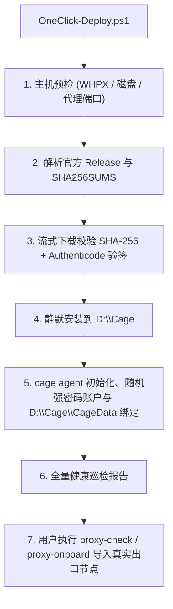

# Claude Cage One-Click (Windows)

[](https://github.com/EmbrainTech/claude-cage-oneclick/actions/workflows/ci.yml)
[](LICENSE)
[](package.json)

面向 Windows x64 的 **[Claude Cage](https://github.com/Lee-xeo/Claude-Cage)** 全自动一键部署、数字签名验真、数据盘分流、代理迁移预检与生命周期运维套件。零第三方 npm 运行依赖，开箱即用。

---

## 核心特性

- **一键全自动部署 (`deploy`)**：串联 `主机预检 → 官方 Release 校验下载 → Authenticode 验签 → NSIS 静默安装 → 服务启动与账户初始化 → 数据盘绑定 → 健康巡检`。
- **智能磁盘分流**：自动识别大容量固定 `D:` 盘，默认将程序安装到 `D:\Cage`、虚拟机存储绑定至 `D:\Cage\CageData`，彻底避免 `C:` 盘被 24 GiB 虚拟磁盘挤爆。
- **双层安全验真**：严格校验官方 `SHA256SUMS` 唯一摘要与精确文件大小，再通过 Windows `Get-AuthenticodeSignature` 验证发布者签名，默认阻断未签名预览包。
- **零凭据泄露设计**：
  - 自动生成的本机高强度账户密码与 `recovery_key` 仅写入 `%USERPROFILE%\.claude-cage\LOCAL_CREDENTIALS.txt`，并通过 `icacls` 收紧为仅当前系统用户可读写。
  - 所有 `cage.exe agent` 敏感载荷均经 `--input -` 标准输入流传入，不进入命令行参数、环境变量或仓库文件。
  - 绝不擅自读取第三方代理软件（Clash Verge、v2rayN 等）私有订阅或凭据文件。
- **代理导入离线预检 (`proxy-check`)**：在导入前静态检测 Clash/Mihomo YAML 与分享链接，提前拦截 `127.0.0.1` 回环节点陷阱、`dialer-proxy` 循环链、SSH 非内联私钥与旧版 WebSocket 字段冲突。

---

## 快速开始

### 前置条件

- **系统**：Windows 10 22H2 (Build 19045+) 或 Windows 11 x64（家庭版可用）
- **运行时**：[Node.js](https://nodejs.org/) `>= 20.0.0`（推荐 Node 24 LTS）
- **虚拟化**：BIOS 已开启 CPU 虚拟化，且 Windows 已启用 **Windows 虚拟机监控程序平台 (`HypervisorPlatform`)**

如未启用 `HypervisorPlatform`，可先以管理员身份运行：

```powershell
.\scripts\Enable-CageHypervisor.ps1 -Apply
```

### 一键部署

在仓库根目录执行单条命令即可完成本机部署与初始化：

```powershell
.\scripts\OneClick-Deploy.ps1
```

可选参数示例：

```powershell
# 固定安装指定版本，并演练流程
.\scripts\OneClick-Deploy.ps1 -Version v0.1.8 -DryRun

# 自定义安装与虚拟磁盘目录
.\scripts\OneClick-Deploy.ps1 -InstallDir D:\Cage -DataDir D:\Cage\CageData
```

### 导入代理并启动隔离环境

1. 先对导出的 Clash/Mihomo YAML 或分享链接文件执行离线预检（参考模板 [examples/clash-template.example.yaml](examples/clash-template.example.yaml)）：

```powershell
node .\bin\cage-oneclick.mjs proxy-check --yaml C:\path\to\nodes.yaml
```

2. 一键导入节点、校验实际出口并自动拉起隔离虚拟机：

```powershell
node .\bin\cage-oneclick.mjs proxy-onboard --yaml C:\path\to\nodes.yaml --start-guest
```

3. 启动桌面工作台：

```powershell
.\scripts\Launch-CageDesktop.ps1
```

---

## CLI 命令总览

| 命令 | 说明 |
| --- | --- |
| `preflight` | 检查 Windows Build、WHPX 虚拟化、QEMU 加速、固定磁盘容量与下载网络 |
| `plan` | 解析上游 Release 元数据、静态下载链接与 `SHA256SUMS` 预期摘要 |
| `install` | 校验下载安装包、验证 Authenticode 签名并执行静默安装 |
| `setup` | 执行 `init`、`service.start`、账户创建/解锁、存储路径绑定与时区语言设置 |
| `deploy` | 一键串联 `preflight -> install -> setup -> doctor` |
| `proxy-check` | 离线检测 Clash/Mihomo YAML 或节点分享链接的合法性与回环陷阱 |
| `proxy-onboard` | 校验并导入代理节点，执行 `settings.probe` 后按需启动隔离环境 |
| `doctor` | 汇总主机环境、安装完整性、账户、存储与代理状态的只读诊断报告 |
| `backup` | 备份 `~/.claude-cage` 核心配置与账户元数据到带 ACL 保护的目录 |

---

## 工作流程



---

## 文档与测试

- [架构与安全边界说明](docs/architecture.md)
- [代理迁移与回环陷阱指南](docs/proxy-migration.md)
- [常见问题排查](docs/troubleshooting.md)

运行全量单元与集成测试（零外部依赖，使用 Node.js 内置 `node:test`）：

```powershell
npm test
```

---

## 致谢与许可

- 本项目基于并服务于开源项目 [Lee-xeo/Claude-Cage](https://github.com/Lee-xeo/Claude-Cage)，安装器下载、校验和 `agent` CLI 协议均遵循上游公开规范。
- 本仓库代码采用 [MIT License](LICENSE) 开源。
