# 架构与隔离原理

`claude-cage-oneclick` 负责在 Windows x64 主机上自动化完成 [Lee-xeo/Claude-Cage](https://github.com/Lee-xeo/Claude-Cage) 的环境预检、可信安装、后台初始化、代理预检与全链路巡检。

## 整体工作流

```mermaid
flowchart LR
  A["OneClick-Deploy.ps1"] --> B["preflight: OS / WHPX / 磁盘 / 下载代理探测"]
  B --> C["bootstrap: SHA256SUMS 校验 + 严格 HTTPS 下载"]
  C --> D["authenticode: PE 数字签名验证"]
  D --> E["NSIS 静默安装到 D:\\Cage"]
  E --> F["cage agent: init / service.start / account.create"]
  F --> G["storage.set -> D:\\Cage\\CageData & settings.patch"]
  G --> H["proxy-check & proxy-onboard: 静态预检 -> stdin 导入 -> probe"]
  H --> I["environment.start: 启动 WHPX 隔离虚拟机"]
```

## 安全与权限边界

1. **凭据零暴露**：`account.create` 与 `proxy.import` 的敏感载荷全部通过 `--input -` 标准输入管道传入 `cage.exe`，绝不写入命令行参数或日志。
2. **本地账户密码保护**：自动生成的本机账户密码与 `recovery_key` 仅写入 `%USERPROFILE%\.claude-cage\LOCAL_CREDENTIALS.txt`，并通过 `icacls.exe /inheritance:r /grant:r` 锁定为仅当前 Windows 用户可读写。
3. **拒绝盲提第三方订阅**：端口探测仅检查本地下载通道是否可达（如 `127.0.0.1:7897`），绝不自动读取 Clash Verge、v2rayN 等第三方客户端的私有配置文件或订阅链接。
4. **双层安装包防篡改**：先校验官方 `SHA256SUMS` 唯一条目与精确字节数，再校验 Windows Authenticode 数字签名，默认拒绝未签名预览包。
